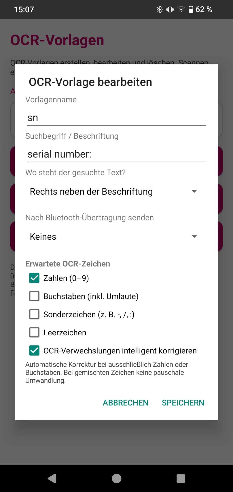
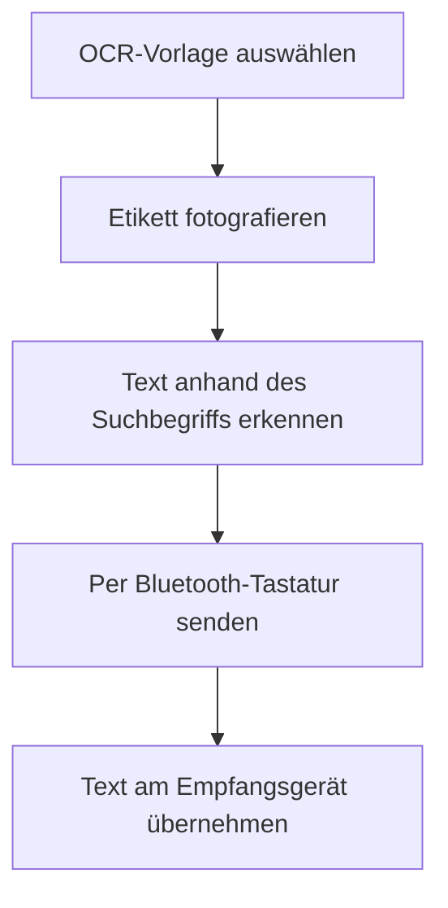

# OCR2BT

  

**Fotografieren statt abtippen.**

OCR2BT ist eine Android-App, mit der sich gedruckte Nummern oder Kennzeichnungen erfassen und als Bluetooth-Tastatureingabe an einen PC oder ein anderes kompatibles Empfangsgerät senden lassen.

## Funktionen

- **OCR-Vorlagen:** Vorlagen erstellen, bearbeiten und auswählen.
- **Gezielte Texterkennung:** Suchtext festlegen; der Text dahinter beziehungsweise im definierten Bereich wird ausgelesen.
- **Übertragung:** Erkannten Text überprüfen und als Bluetooth-HID-Tastatureingabe senden.
- **Abschlusszeichen:** Wahlweise **Enter** oder **Tab** nach dem Text übertragen.

## Einblicke in die App

Die folgenden Bilder zeigen die echte Android-Oberfläche von OCR2BT. Zum Vergrößern einfach auf einen Screenshot klicken.

| Startseite | OCR-Vorlagen | Vorlage bearbeiten |
|:---:|:---:|:---:|
|  |  |  |
| Vorlage auswählen, fotografieren und Text senden | Vorlagen verwalten | Suchtext und Übertragungsregeln festlegen |

## Ablauf

Optional wird nach dem Text ein Enter- oder Tab-Zeichen gesendet.

## Datenschutz und Google ML Kit

OCR2BT verwendet **Google ML Kit (Texterkennung)**. Nach Angaben von Google werden die aufgenommenen Bilddaten und die erkannten Texte bei dieser ML-Kit-Funktion **auf dem Gerät verarbeitet** und nicht zur Texterkennung an Google-Server gesendet. Google ML Kit kann jedoch geräte-, appbezogene und technische Diagnose- und Nutzungsinformationen erfassen und an Google übertragen. Weitere Informationen: [Google ML Kit – Datenoffenlegung](https://developers.google.com/ml-kit/android-data-disclosure) und [Nutzungsbedingungen und Datenschutz](https://developers.google.com/ml-kit/terms).

Für eine **manuell gestartete Updateprüfung** greift OCR2BT auf die öffentlichen GitHub-Releases dieses Projekts zu. Die App kann zudem Bluetooth-Verbindungen zu vom Nutzer ausgewählten Geräten aufbauen. Dieser Hinweis beschreibt den vorgesehenen App-Ablauf, ersetzt aber keine unabhängige Überprüfung aller Datenflüsse.

## Download

Die aktuelle Android-APK und eine passende Quellcode-ZIP stehen unter [GitHub Releases](https://github.com/ingo008/OCR2BT-Releases/releases) bereit. Die APK kann nach Freigabe der Installation aus dieser Quelle unter Android installiert werden.

## Quellcode, Lizenzen und Transparenz

Der Quellcode wird öffentlich **zur Einsichtnahme** bereitgestellt. So können Interessierte nachvollziehen, welche Funktionen in OCR2BT vorgesehen sind. Die Veröffentlichung ist **keine Open-Source-Lizenz**: Für die eigenen Programmteile gelten **alle Rechte vorbehalten**, soweit keine ausdrückliche andere Erlaubnis erteilt wird. Rechte aus Lizenzen verwendeter Drittanbieterkomponenten bleiben davon unberührt.

OCR2BT verwendet unter anderem **AndroidX**, **Kotlin** und **Google ML Kit** einschließlich indirekt eingebundener Google-Play-Services-, Firebase- und weiterer Hilfsbibliotheken. Zahlreiche AndroidX- und Kotlin-Komponenten stehen unter der **Apache License 2.0**. Für Google ML Kit und andere Google-SDK-Komponenten gelten zusätzliche beziehungsweise eigene Nutzungsbedingungen. Lizenzinformationen und weiterführende Links sind in der Datei `LIZENZHINWEISE.md` der Quellcode-ZIP dokumentiert. Die vollständigen versionsbezogenen Lizenz- und NOTICE-Texte aller indirekten Abhängigkeiten werden vor einer abschließenden Lizenzfreigabe noch geprüft.

**Hinweis:** Die Einsicht in den Quellcode ist ein Transparenzangebot, aber für sich genommen kein kryptografischer Nachweis, dass eine heruntergeladene APK exakt aus diesen Quellen gebaut wurde.

## Entwicklung

OCR2BT wurde von **ingo008 unter Einsatz von KI-Technologie von OpenAI entwickelt**.
