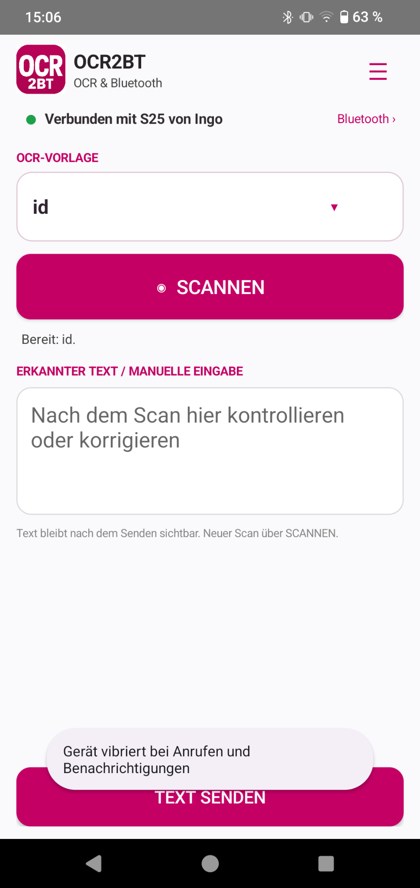
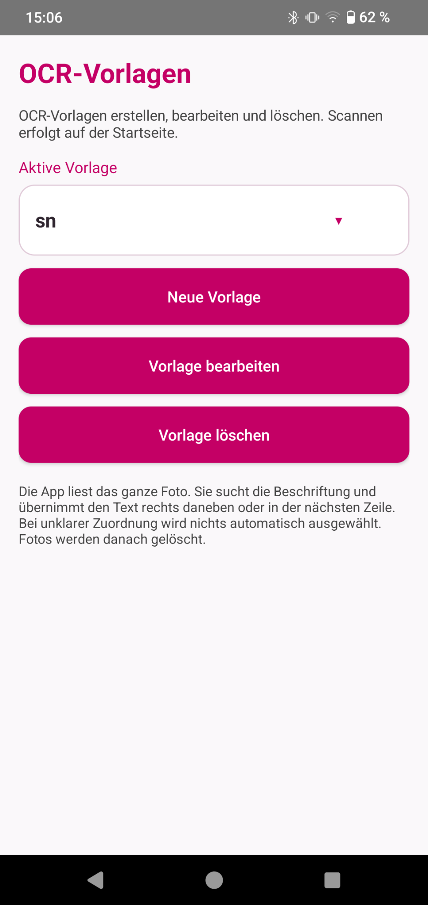
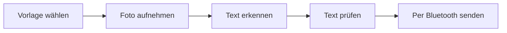

  

# OCR2BT

**Fotografieren statt abtippen.**

OCR2BT erkennt gedruckte Texte wie Seriennummern oder Gerätekennzeichnungen und überträgt sie als **Bluetooth-Tastatureingabe** an einen PC oder ein kompatibles Empfangsgerät – besonders praktisch, wenn kein Barcode oder QR-Code vorhanden ist.

## Funktionen

- **OCR-Vorlagen:** Suchbegriff und Position des auszulesenden Textes festlegen.
- **Texterkennung:** Fotografieren, erkannten Text prüfen und bei Bedarf bearbeiten.
- **Bluetooth-Übertragung:** Text wie mit einer Tastatur senden; optional mit **Enter**, **Tab** oder ohne Zusatzzeichen.

## Einblicke

| Startseite | OCR-Vorlagen | Vorlage bearbeiten |
|:---:|:---:|:---:|
|  |  |  |

## So funktioniert's

## Download

Die Android-App steht als APK unter **[Releases](https://github.com/ingo008/OCR2BT-Releases/releases)** zur Verfügung. Dort kann auch der Quellcode der jeweiligen Version zur Einsicht bereitgestellt werden.

## Datenschutz und Quellcode

Die Texterkennung erfolgt mit **Google ML Kit** auf dem Gerät. Google kann dabei technische Nutzungs- und Diagnosedaten erfassen. Eine manuelle Updateprüfung verbindet sich mit GitHub. Weitere Informationen: [Google ML Kit – Datenoffenlegung](https://developers.google.com/ml-kit/android-data-disclosure).

Der veröffentlichte Quellcode dient der **Transparenz und Einsichtnahme**. Für den eigenen Programmcode gelten **alle Rechte vorbehalten**; für verwendete Bibliotheken gelten deren jeweilige Lizenzbedingungen. Lizenzhinweise liegen der Quellcode-ZIP bei.

## Entwicklung

OCR2BT wurde von **ingo008 unter Einsatz von KI-Technologie von OpenAI** entwickelt.
